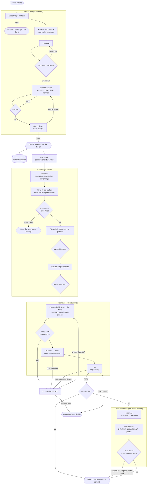
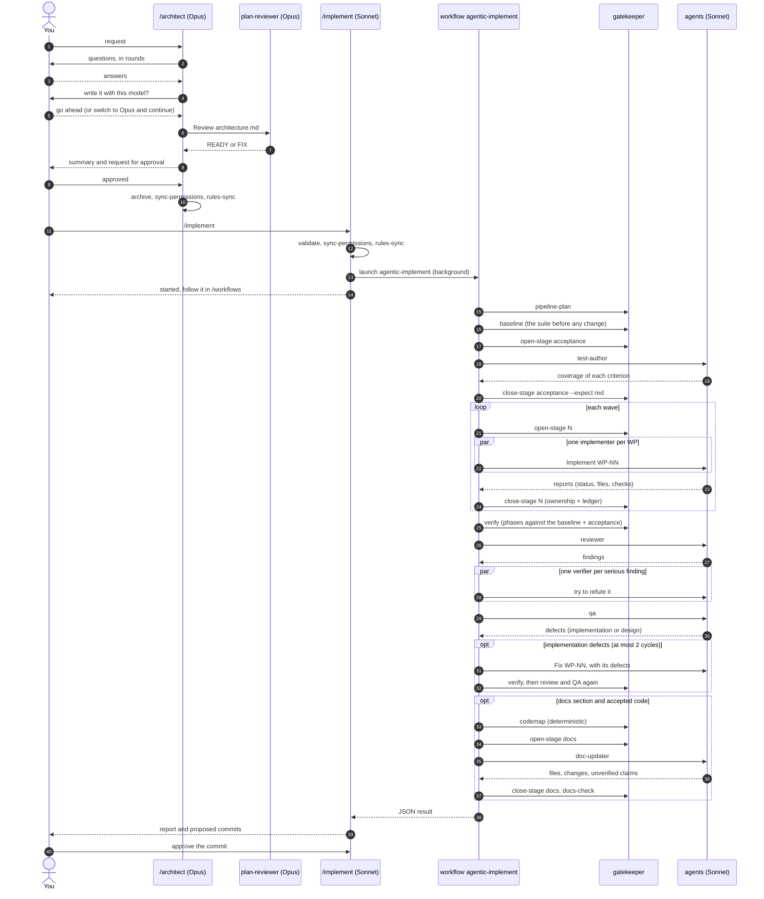
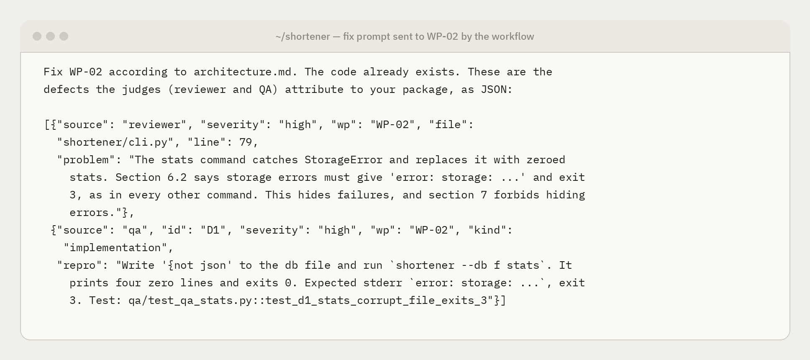
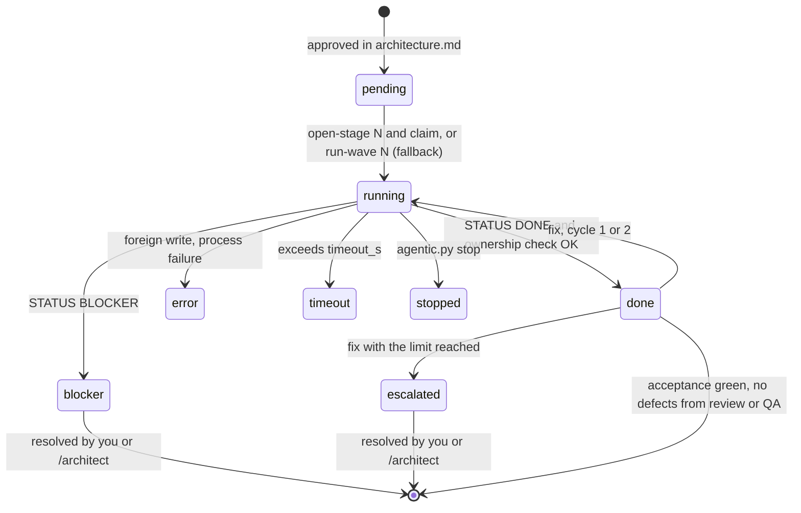
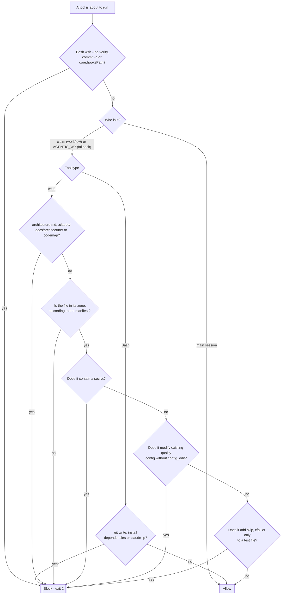
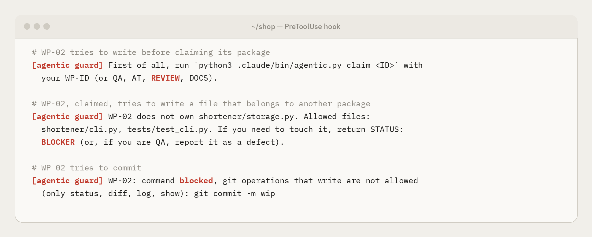
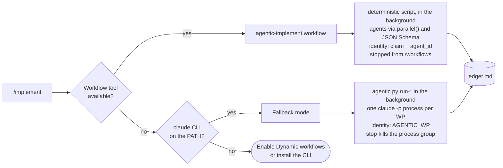

# How agentic-flow works

The technical reference: which pieces exist, in what order they act, who may write what, and where you come in. To set it up in your environment, see the [guides](how-to/README.md).

1. [Overview](#1-overview)
2. [One run, step by step](#2-one-run-step-by-step)
3. [Lifecycle of a work package](#3-lifecycle-of-a-work-package)
4. [Guardrails: the hook's decision](#4-guardrails-the-hooks-decision)
5. [Permission matrix](#5-permission-matrix)
6. [Native workflow and fallback mode](#6-native-workflow-and-fallback-mode)
7. [Files and state](#7-files-and-state)
8. [Glossary](#8-glossary)


## 1. Overview

Four phases and two human gates. Each box is an agent or a deterministic step of `agentic.py`.



## 2. One run, step by step

`/implement` validates and launches the native workflow `agentic-implement`, which runs in the background. The script decides what comes next; the deterministic steps are run by the `gatekeeper` agent through `agentic.py`. Dashed arrows are replies, each one validated against a JSON Schema.



When a judge finds a real defect, the workflow sends it back to the package that owns it, with the evidence. This is the prompt WP-02 received in a real run, after the reviewer and QA found the same defect independently:

<p align="center"></p>

And this is how the launcher reports the end of that run, before you approve anything:

<p align="center"></p>

## 3. Lifecycle of a work package

States as they appear in the ledger (`agentic.py status`).



The ledger is written by `agentic.py`, not by the model, so it survives context compaction and answers "how is it going?". This one is from the run above; `DONE (fix)` marks the package that went through a fix cycle:

<p align="center"></p>

## 4. Guardrails: the hook's decision

The `PreToolUse` hook (`agentic.py hook`) runs before every Write, Edit, MultiEdit, NotebookEdit and Bash call. It **fails closed**: inside an agent of the flow, any error blocks.



An agent of the flow must claim its zone before it can write anything; that includes custom agents a package declares in its `agent` field. The messages say what was blocked and what to do instead:

<p align="center"></p>

On top of the hook, closing each stage compares the fingerprint of every file before and after. Any change outside that stage's zones leaves it in `REVIEW`, including changes made through Bash to dodge the hook.

## 5. Permission matrix

| Agent | Model | Writes to | Runs | May not |
|---|---|---|---|---|
| Architect (`/architect`) | latest Opus | `architecture.md`, `docs/architecture/` | `agentic.py validate`, `stack`, `codemap`, `sync-permissions`, `rules-sync` | write code or tests |
| plan-reviewer | latest Opus | nothing | nothing | write |
| Launcher (`/implement`) | latest Sonnet | nothing (the ledger, through the script) | `agentic.py`, the Workflow tool | write code or tests, commit without your approval |
| Workflow `agentic-implement` | n/a (script) | nothing: it has no shell or disk | agents only | skip the script's order or limits |
| gatekeeper | latest Sonnet | nothing directly (`agentic.py` writes state) | only `python3 .claude/bin/agentic.py …` | run any other command |
| verifier | latest Sonnet | nothing | nothing (reads only) | write |
| test-author (`AT`) | latest Sonnet | `acceptance.files` (default `acceptance/`) | `allow_bash` + the acceptance command | write production code |
| implementer (`WP-NN`) | latest Sonnet | its package's `files` | `allow_bash` + the acceptance command | touch other files, `acceptance/`, git, dependencies |
| reviewer (`REVIEW`) | latest Sonnet | nothing | `git diff/status/log` + `allow_bash` | write |
| qa (`QA`) | latest Sonnet | `qa.files` (default `qa/`) | `allow_bash` | write production code |
| doc-updater (`DOCS`) | latest Sonnet | `docs.files` (default `README.md`, `CHANGELOG.md`, `docs/`) | `git diff/status/log` | write code, tests, the codemap, `docs/architecture/` |

For every agent of the flow: no secrets, no `--no-verify`, no relaxing existing configuration, no disabling tests. Nobody may own `architecture.md`, `.claude/` or `docs/architecture/`, and the hook blocks writes to them (and to the codemap) even when a zone includes them by prefix, such as `docs/`.

## 6. Native workflow and fallback mode



| | Native workflow (default) | Fallback mode (`fallback`) |
|---|---|---|
| Requirement | Dynamic workflows enabled (on Pro, in `/config`, or `"enableWorkflows": true`) | The `claude` CLI on the `PATH` |
| Where it works | CLI, Desktop, IDEs, `claude -p` and the cloud | Wherever the CLI is: terminal, Desktop, IDEs |
| Orchestration | The script, deterministically | The launcher, following `/implement`'s instructions |
| Reports | JSON validated against a schema | Text with `STATUS:`, read by a regex |
| Review | Adversarial verification of every serious finding | No adversarial verification |
| Usage limit on Pro | The run pauses and resumes by itself (interactive sessions) | Running agents fail; relaunch by hand |
| Following it | `/workflows` and the ledger | The ledger |

## 7. Files and state

```
.claude/
├── commands/
│   ├── architect.md        /architect   (latest Opus)
│   └── implement.md        /implement   (latest Sonnet)
├── agents/
│   ├── plan-reviewer.md    latest Opus, read-only
│   ├── gatekeeper.md       runs agentic.py for the workflow
│   ├── verifier.md         tries to refute serious findings, read-only
│   ├── test-author.md      wave 0
│   ├── implementer.md      one work package
│   ├── reviewer.md         read-only
│   ├── qa.md               exploratory
│   └── doc-updater.md      living documentation, docs zone
├── workflows/
│   └── agentic-implement.js   the whole pipeline as a native workflow
├── rules-library/          common rules and 10 languages (source)
├── rules/agentic/          installed by rules-sync; Claude Code loads .claude/rules/
├── bin/
│   ├── agentic.py          validate · pipeline-plan · open/close-stage · verify · stack · rules-sync · codemap ·
│   │                       docs-check · install · run-* · status · stop · hook
│   ├── test_agentic.py     tests of agentic.py, the hook and the installer
│   ├── test_definitions.py tests of the definitions: agents, rules, plugin, CI and documentation
│   └── test_workflow.mjs   tests of the workflow logic with simulated agents
├── settings.json           PreToolUse hook + permissions
├── agentic.json            timeout_s · auth · max_fix_cycles
├── agentic-install.json    version and file fingerprints, when installed by the plugin
└── state/                  (ignored by git)
    ├── ledger.md           readable state
    ├── runs/<ID>.json      each agent's report
    └── snapshot-*.json     fingerprints for the ownership check
architecture.md             the current contract
docs/architecture/          approved designs + decision index
docs/CODEMAP.md             code map, generated (with a docs section)
acceptance/  qa/            acceptance and QA tests
.claude-plugin/  plugin/    template only: the plugin that installs everything above
```

## 8. Glossary

- **Work package (WP):** a unit of work with its own files, assigned to one implementer.
- **Wave:** a group of packages that run in parallel. A wave depends only on earlier waves.
- **AC-NNN:** an observable acceptance criterion, with its "must not" and its automatic check.
- **Wave 0:** the test-author turns the criteria into tests before any code exists.
- **Manifest:** the `json wp-manifest` block in `architecture.md`, read by every guardrail.
- **Ledger:** `.claude/state/ledger.md`, the state of agents and stages, written by the script, not by the model.
- **Ownership check (`check-wave`):** a comparison of file fingerprints before and after a stage, to catch writes outside a zone.
- **Baseline:** build, types, lint and tests before any change (`.claude/state/baseline.json`). When verifying, a phase that passed and now fails is a **regression** (blocks); one that already failed is a **pre-existing failure** (reported, never blamed on a package).
- **Patterns to mirror (`mirror`):** `file:lines` references to existing code that each package must imitate. `validate` checks that they exist.
- **Human gates:** approving the design and approving the commit. Nothing crosses a gate without you.
- **Native workflow:** a Claude Code script (`.claude/workflows/`) that orchestrates subagents deterministically, in the background. Here, `agentic-implement`.
- **gatekeeper:** the agent that runs `agentic.py`'s deterministic steps for the workflow, which has no shell.
- **Stack and rules:** the manifest's `stack` lists the project's languages. `rules-sync` installs the common rules and those languages' rules in `.claude/rules/agentic/`, and the workflow hands the list to each agent. Precedence: `architecture.md`, the existing code, the project's own rules, then these.
- **Living documentation:** the last stage, only with accepted code. The **codemap** (files and public symbols) is generated by `agentic.py` with no model and no date, so it only changes when the code does. The doc-updater updates what users read, and `docs-check` validates links, anchors and paths.
- **Plugin:** `agentic-flow`, with a single command, `/agentic-flow:init`, that installs or updates the flow in a repo without overwriting your changes.
