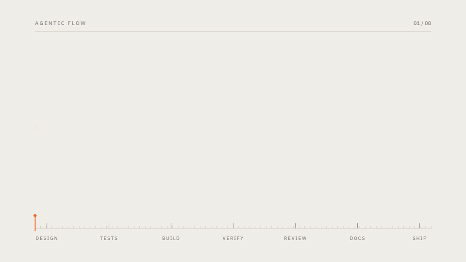
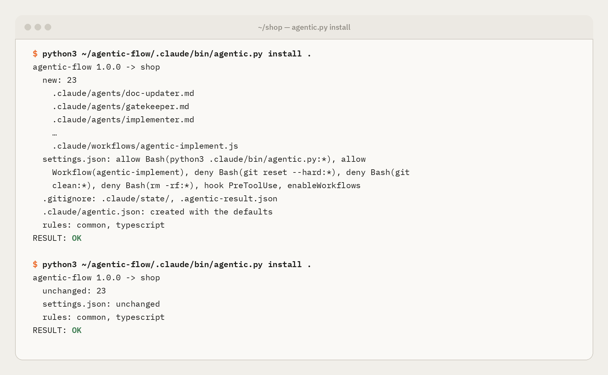
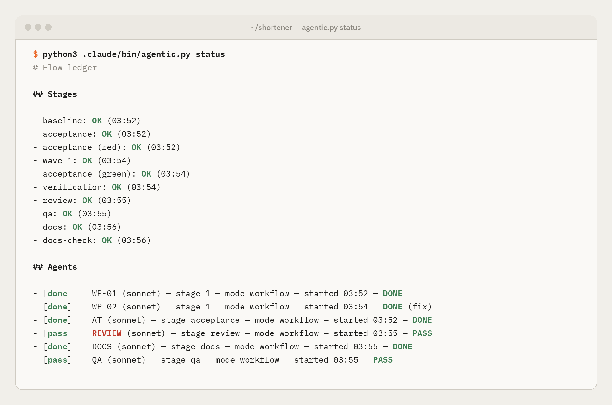
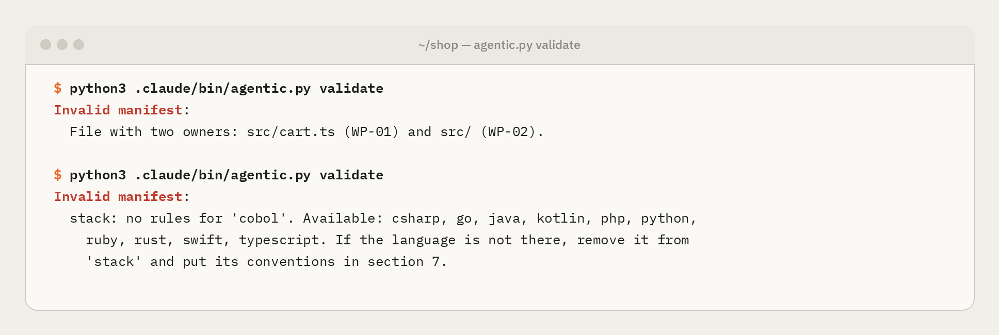

# Guides: building with agentic-flow

> Reviewed on 2026-10-19 with Claude Code 2.1.302 and the official documentation at [code.claude.com/docs](https://code.claude.com/docs/en/overview).
> Read this page first: it covers what every environment shares. Then follow the guide for yours.
> For the diagrams (sequence, lifecycle, the hook's decision, permissions), see [How it works](../how-it-works.md).

## Pick your environment

| Environment | Guide | Best for | Status |
|---|---|---|---|
| Terminal (CLI) | [terminal.md](terminal.md) | Full control, scripting, SSH | **Tested**: complete `/implement` with the native workflow, including a real fix cycle and living docs; the fallback mode end to end |
| Claude Code Desktop | [desktop.md](desktop.md) | Everyday work with a graphical interface | **Partly tested**: scripts and agents run from the app; the `/architect` interview in the UI, not yet |
| VS Code / Cursor | [vscode.md](vscode.md) | Reviewing diffs in the editor | Not tested |
| JetBrains | [jetbrains.md](jetbrains.md) | IntelliJ, PyCharm, WebStorm… | Not tested |
| Web and iOS (cloud) | [web-ios.md](web-ios.md) | Starting or following work away from your machine | Not tested |
| GitHub Actions | [ci-github-actions.md](ci-github-actions.md) | Automatic QA on every pull request | Not tested |
| Plugin | [plugin.md](plugin.md) | Installing or updating the flow in an existing repo | **Tested** in a real session with `--plugin-dir`; from the marketplace, not yet |

## The flow in one minute



| Piece | File | Model | Does | May not |
|---|---|---|---|---|
| Architect | `.claude/commands/architect.md` | latest Opus | Classifies, researches, interviews and writes `architecture.md` | Write code or tests |
| Plan reviewer | `.claude/agents/plan-reviewer.md` | latest Opus | Critiques `architecture.md` in a clean context before you approve it | Write anything |
| Launcher | `.claude/commands/implement.md` | latest Sonnet | Validates, launches the workflow, reports and holds the commit gate | Interpret the design or resolve blockers |
| Test-author | `.claude/agents/test-author.md` | latest Sonnet | Writes the acceptance tests from the criteria, before the code | Implement |
| Implementer | `.claude/agents/implementer.md` | latest Sonnet | Builds one work package with its unit tests | Touch other packages' files or the acceptance tests |
| Reviewer | `.claude/agents/reviewer.md` | latest Sonnet | Reviews quality and security, reporting only what it can prove | Write anything |
| Verifier | `.claude/agents/verifier.md` | latest Sonnet | Tries to refute each serious finding | Write anything |
| QA | `.claude/agents/qa.md` | latest Sonnet | Exploratory tests in `qa/`, beyond the criteria | Fix production code |
| Doc-updater | `.claude/agents/doc-updater.md` | latest Sonnet | Updates README, CHANGELOG and guides once the code is accepted | Leave its `docs` zone, touch the code map or the decision archive |

### Why this order

- **Tests first, written by someone else.** The agent that writes the code does not write the exam. The test-author writes the acceptance tests before the code exists, checks that they fail, and the hook stops anyone else from touching them. An implementer cannot pass by weakening a test.
- **The plan gets reviewed too.** Whoever writes a plan tends to believe it. A second Opus that never saw the conversation reads it the way the implementers will.
- **Ceremony scaled to the change.** A trivial change skips the flow. A fix starts with a test that reproduces the bug. A refactor requires the suite to be green before and after.
- **People decide what is right; the machine measures.** You have two gates: the design and the commit. Fix loops have a limit.

Models are set by alias and cannot be changed: `validate` fails if any piece declares another one. Each alias points to the newest model your Claude Code knows, so keep Claude Code up to date.

### Two ways to run

- **Native workflow (default).** `/implement` launches the `agentic-implement` workflow (`.claude/workflows/`), a Claude Code script that runs the whole pipeline deterministically in the background: agents in parallel, schema-validated reports and adversarial review. Follow it with `/workflows`. On Pro, enable **Dynamic workflows** in `/config`; the template already sets `"enableWorkflows": true`.
- **Fallback mode.** Without workflows, `/implement` uses `agentic.py run-*`, which starts one `claude -p` process per package. It needs the `claude` CLI on the `PATH`.

`/implement` picks automatically. To force the fallback: `/implement fallback`. Both are diagrammed in [How it works § 6](../how-it-works.md#6-native-workflow-and-fallback-mode).


## Requirements

1. **A plan:** Pro, Max, Team or Enterprise (or a Console account). The free plan does not include Claude Code.
2. **The Claude Code CLI.** The fallback mode needs it; with the native workflow it is recommended but optional. The desktop app and the VS Code extension ship their own Claude Code, but that does not put `claude` on your `PATH`. The recommended installer updates itself:

   ```bash
   curl -fsSL https://claude.ai/install.sh | bash
   ```

3. **`git` and `python3` 3.9 or later.**
4. **macOS, Linux or WSL 2.** Claude Code runs on native Windows, but `agentic.py` uses `fcntl`, which only exists on POSIX. On Windows, work inside WSL.

Check your setup:

```bash
claude --version
```

```bash
claude doctor
```

```bash
claude auth status
```

```bash
python3 --version
```

You should see a Claude Code version, `claude doctor` without errors, `"authMethod": "claude.ai"` with your `subscriptionType`, and Python 3.9 or later.

## Install the flow in a project

**A new project**, from the template:

```bash
gh repo create my-project --template jagosar/agentic-flow --private --clone
```

**An existing project, with the plugin (recommended).** In a Claude Code session inside the repo, run `/plugin install agentic-flow --marketplace jagosar/agentic-flow`, then `/agentic-flow:init`. [plugin.md](plugin.md) covers updates and what happens to your own changes.

**An existing project, by hand:**

```bash
git clone --depth 1 https://github.com/jagosar/agentic-flow /tmp/agentic-flow
```

```bash
python3 /tmp/agentic-flow/.claude/bin/agentic.py install .
```

It is the same installer the plugin uses. It copies the flow, adds what it needs to your `.claude/settings.json` without removing anything of yours, and detects your languages. Running it again is safe:

<p align="center"></p>

Commit it, so your team, CI and cloud sessions get the flow too:

```bash
git add .claude .gitignore && git commit -m "Add agentic flow"
```

Then open `claude` once in the folder and **accept the trust prompt**. Without it, Claude Code ignores the project's `permissions.allow`; hooks and `deny` rules apply anyway.

Check it:

```bash
python3 .claude/bin/agentic.py validate
```

In a project without a design yet, the expected answer is `.../architecture.md does not exist. Run /architect first.` Any message about `model:` means a definition has been modified.

## The working cycle

1. **Design:** `/architect <request>`. Include the goal, the scope and any constraint you already know; the interview refines the rest. Before writing `architecture.md`, it names the model it is running on and waits for your go-ahead, so you can switch to Opus first.
2. **Read the plan:** especially section 6 (contracts) and section 8 (work packages and waves). If every wave has a single package, ask for "contracts first" to get parallelism.
3. **Commit the design:**

   ```bash
   git add architecture.md && git commit -m "Architecture: <topic>"
   ```

4. **Build:** `/implement`. It records the baseline, then runs wave 0 (acceptance tests), the waves, the phased verification (which separates regressions from pre-existing failures), review, QA, fixes and the documentation.
5. **Read the report.** Defects of implementation are fixed automatically, at most twice per package; design defects come back to you, to take to `/architect`.
6. **Commit and push.** Do it yourself or ask the main session. The flow's agents cannot: the hook blocks them.

If a stage stops (a blocked package, a broken acceptance test), fix the cause and resume from that wave with `/implement <wave>`.

## Good practice

- **A `CLAUDE.md` at the root** with the repo's conventions (style, test commands, prohibitions). Every agent reads it.
- **In existing code, demand references.** Every package should list its "patterns to mirror" with `file:lines`. A plan that says "follow the project's style" without pointing at it is incomplete.
- **Exact contracts.** Parallelism depends on section 6. A vague contract does not fail in the wave; it fails at integration.
- **One feature per session**, each on its own branch or worktree, with its own `architecture.md`.
- **Don't edit a package's files by hand while its wave runs:** the ownership check would flag it.
- **Commit after each wave** on long jobs, to have a point to return to.
- **Declare the `stack`.** With `"stack": ["python"]` in the manifest, agents get that language's rules even in an empty repo.
- **Turn on living documentation** with a `docs` section in the manifest. If a package must write real documentation (an API manual, say), keep it out of the `docs` zone: a file cannot have two owners.
- **On Pro, keep an eye on `/usage`.** Several agents in parallel spend the plan's limits quickly.

## Language rules

`.claude/rules-library/` holds the common rules (`common.md`) and rules for ten languages: Python, TypeScript/JavaScript, Go, Rust, Java, Kotlin, C#, Ruby, PHP and Swift, adapted from ECC. Each has the same sections: style, errors, tests, security and the usual commands for `verify`.

- **Installed by** `rules-sync`, when `/architect` finishes and when `/implement` starts. It copies to `.claude/rules/agentic/` the common rules, the rules of the manifest's `stack` and those of the languages it detects.
- **Delivered to the agents twice:** Claude Code loads `.claude/rules/` by itself (language rules only around files of that language, thanks to `paths:`), and the workflow also passes the list in every agent's prompt.
- **When they disagree:** `architecture.md` wins, then the existing code, then your own rules, then these.
- **To adapt them:** put your rules in `.claude/rules/`, outside `agentic/` (which `rules-sync` rewrites). If you edit a library file, plugin updates leave it alone.
- **A language without rules:** remove it from `stack` and write its conventions in section 7.

## Follow and stop the work

- **The session stays free.** Waves and QA run in the background; keep talking to the session while they work.
- **"How is it going?"** The launcher answers from the **ledger**, `.claude/state/ledger.md`, written by `agentic.py` rather than the model, so it survives context compaction:

  <p align="center"></p>

- **"Stop."** With the native workflow, from `/workflows`: select the run and press `x`; `p` pauses and resumes, and a stopped run can be relaunched, reusing what already finished. In the fallback mode, `agentic.py stop` kills the processes and the stage ends in `REVISAR` with `STOPPED`.
- **Short reports.** Implementers and QA answer in under 300 words, result first. The full result of each workflow run is saved in `.claude/state/runs/workflow-result.json`.

## Configuration

`.claude/agentic.json`:

```json
{
  "timeout_s": 1800,
  "auth": "subscription",
  "max_fix_cycles": 2
}
```

- **`timeout_s`:** the longest a stage may run; agents still alive are ended and marked `TIMEOUT`. For a one-off change: `AGENTIC_TIMEOUT_S`.
- **`auth: "subscription"`:** agents run on your subscription. In `-p` mode Claude Code uses `ANTHROPIC_API_KEY` whenever it exists, so the launcher removes `ANTHROPIC_API_KEY` and `ANTHROPIC_AUTH_TOKEN` from the agents' environment. Use `"inherit"` only to bill the API.
- **`max_fix_cycles`:** fix cycles allowed per package before it escalates to a person.
- **Models:** not configurable; set by alias.

## Script reference

```bash
python3 .claude/bin/agentic.py validate                # manifest and models are consistent
python3 .claude/bin/agentic.py sync-permissions        # agents' permissions in settings.local.json
python3 .claude/bin/agentic.py pipeline-plan           # the plan the workflow follows (JSON)
python3 .claude/bin/agentic.py baseline                # the suite before any change
python3 .claude/bin/agentic.py verify                  # phases against the baseline + acceptance (JSON)
python3 .claude/bin/agentic.py stack                   # detected languages against the manifest's stack
python3 .claude/bin/agentic.py rules-sync              # installs the stack's rules in .claude/rules/agentic/
python3 .claude/bin/agentic.py codemap                 # deterministic code map in docs/CODEMAP.md
python3 .claude/bin/agentic.py docs-check              # links, anchors and paths in the documentation
python3 .claude/bin/agentic.py install ../other-repo   # installs or updates the flow in another repo
python3 .claude/bin/agentic.py status                  # the ledger: every agent and stage
python3 .claude/bin/agentic.py stop                    # stops every running agent
python3 .claude/bin/agentic.py stop WP-02              # stops one
python3 .claude/bin/agentic.py mark WP-02 blocker note # annotates by hand
# Fallback mode, stage by stage:
python3 .claude/bin/agentic.py run-acceptance          # wave 0: the test-author writes the acceptance tests
python3 .claude/bin/agentic.py acceptance --expect red # they must fail before the code
python3 .claude/bin/agentic.py run-wave 1              # wave 1 in parallel
python3 .claude/bin/agentic.py run-wave 1 WP-02        # a single package
python3 .claude/bin/agentic.py run-wave 1 WP-02 --fix  # fix its defects from review or QA
python3 .claude/bin/agentic.py acceptance --expect green  # they must pass afterwards
python3 .claude/bin/agentic.py run-review              # code reviewer (read-only)
python3 .claude/bin/agentic.py run-qa                  # QA agent
python3 .claude/bin/agentic.py run-docs                # doc-updater, after codemap
python3 .claude/bin/agentic.py check-wave 1            # ownership check
```

- **Exit codes:** `0` all good, `1` usage error or invalid manifest, `3` needs review, `4` the fix-cycle limit was reached.
- **Each agent's report** (fallback mode): `.claude/state/runs/<ID>.json` (field `result`) and `<ID>.log`.

## Troubleshooting

The messages below are quoted as the flow prints them (the first words are enough to find them).

| Message or symptom | Cause | Fix |
|---|---|---|
| `does not support this model; version X or newer is required` | An old CLI for a new model | `claude update`. With npm: `npm install -g @anthropic-ai/claude-code@latest` (with nvm, use nvm's npm) |
| `Ignoring 1 permissions.allow entry ... not been trusted` | The folder is not trusted | Open `claude` in it once and accept the prompt |
| `Invalid manifest: ... model: sonnet` or `opus` | Someone pinned another model in an agent or command | Restore `model: sonnet` (working agents and `/implement`) or `model: opus` (`/architect`, `plan-reviewer`) |
| `File with two owners` | Two zones overlap in the manifest | Fix the manifest with `/architect`; see the example below |
| `RESULT: REVIEW` without a `STATUS` | The child process failed (usage limit, network, auth) | Read `.claude/state/runs/<ID>.log` |
| `TIMEOUT` | The stage exceeded `timeout_s` | Raise `timeout_s` or split the package |
| `OUTSIDE OWNERSHIP` | An agent wrote outside its zone, or a build artefact is not ignored | Check `git diff`. For an artefact (`dist/`…), add it to `ignore` in the manifest |
| `[agentic guard] ... does not own ...` | The hook did its job | If the file should belong to that package, fix the manifest with `/architect` |
| `ALREADY PASS WITHOUT CODE` in wave 0 | The acceptance tests prove nothing | Revisit the criteria with `/architect`: they lack a concrete observable result |
| `has used up its 2 --fix cycles` | The defect won't yield to repetition | Decide yourself, or change the contract or the criterion with `/architect` |
| `mirror points to a file that does not exist` / `out of range` | The plan cites code that is not there | Ask `/architect` to correct the "patterns to mirror" |
| Verification reports a `pre-existing failure` | That phase failed before the run | It neither blocks nor is blamed on a package. Fix it separately, or request it as a `fix` |
| `... is existing quality configuration` | An agent tried to relax a linter or formatter | As intended. If the design really requires it, add `"config_edit": true` to that package with `/architect` |
| `tests are not disabled to turn them green` | An agent tried to add `skip`, `xfail` or `only` | Fix the test or report a `BLOCKER`. Conditional skips (`skipIf`) are allowed |
| `... looks like an AWS access key` (or another credential) | An agent was about to write something shaped like a credential | Use environment variables or synthetic values |
| `bypassing git hooks ... is not allowed` | `--no-verify`, `commit -n` or `core.hooksPath` | Fix what makes the git hook fail |
| A package returns `BLOCKER` about its acceptance tests | A test is wrong and the package cannot touch it | Check the diagnosis, fix the test, and resume with `/implement <wave>` |
| Every wave has a single package | The architect chose real layers | Ask for "contracts first" |
| `/implement` uses the fallback mode on Pro | Workflows are not enabled | Enable them in `/config` (Dynamic workflows) or with `"enableWorkflows": true` |
| The workflow stops to ask permission for a command | Rules missing in `settings.local.json` | Run `agentic.py sync-permissions`, or choose "always allow" the first time |

`validate` explains what is wrong and how to fix it:

<p align="center"></p>

## Testing the flow itself

```bash
python3 -m unittest discover -s .claude/bin -p "test_*.py"
```

```bash
node .claude/bin/test_workflow.mjs
```

130 Python tests and 21 workflow scenarios with simulated agents. Besides the guardrails and the commands, they test the definitions themselves: each agent's model and tools; required sections (injection defence, `claim`, report format); that the workflow only uses agents and commands that exist; that the documentation cites no missing command and has no broken link; no personal paths in the repo; SHA-pinned actions and npm without install scripts in CI; one rule file per detectable language, with the same skeleton; and a plugin that exposes no agents or hooks of its own. Change a prompt and break one of those rules, and a test fails.

The animation and the screenshots are generated from the repo: `python3 docs/assets/make_flow_gif.py` and `python3 docs/assets/make_screens.py` (Pillow and the IBM Plex fonts).

## Official references

- [Setup and updates](https://code.claude.com/docs/en/setup)
- [Authentication and credential precedence](https://code.claude.com/docs/en/authentication)
- [Subagents](https://code.claude.com/docs/en/sub-agents)
- [Commands and skills](https://code.claude.com/docs/en/slash-commands)
- [Hooks](https://code.claude.com/docs/en/hooks)
- [Workflows](https://code.claude.com/docs/en/workflows)
- [Plugins](https://code.claude.com/docs/en/plugins-reference)
- [Claude Code best practices](https://code.claude.com/docs/en/best-practices)
