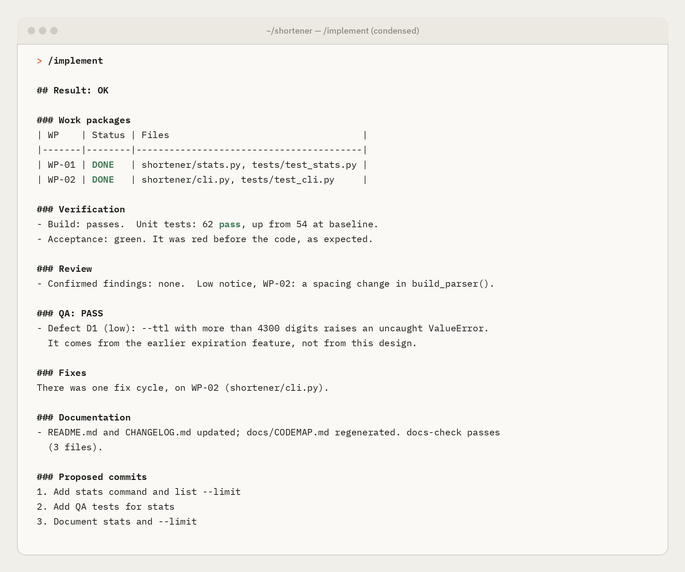

# Guide: Claude Code in the terminal

**Goal:** run the whole flow from a terminal, interactively or from scripts.
**Status:** tested with Claude Code 2.1.302, with real agents:
- a complete `/implement` with the native workflow, from wave 0 to a closed ledger;
- an existing codebase, with no regressions and backward-compatible data;
- a fix cycle with an injected defect, plus the living documentation;
- the fallback mode, end to end.

Before you start, meet the [requirements](README.md#requirements) and [install the flow in your project](README.md#install-the-flow-in-a-project).

## 1. Install and start

The native installer is recommended; it updates itself:

```bash
curl -fsSL https://claude.ai/install.sh | bash
```

Open a new terminal and check it:

```bash
claude --version
```

Go to the project and start Claude Code:

```bash
cd ~/code/my-project && claude
```

The first time, a browser opens to sign in, and Claude Code asks whether you trust the folder. Accept: without it, the project's permissions are ignored.

## 2. Design

Inside the session:

```
/architect Move the payments module from REST to gRPC, keeping the public API
```

- The command asks for the latest Opus by itself.
- Answer the rounds of questions with the arrow keys and `Enter`.
- Before writing `architecture.md`, it tells you which model it is running on and asks whether to go ahead. If it is not Opus, choose **Pause to switch model**, run `/model opus` and reply `continue`.
- You get `architecture.md`, the message `Manifest valid` and a request for approval.

Read the document in your editor, then commit it:

```bash
git add architecture.md && git commit -m "Architecture: gRPC payments"
```

## 3. Build

```
/implement
```

- The launcher switches to the latest Sonnet, validates, syncs permissions and rules, and starts the `agentic-implement` workflow in the background. Follow it with `/workflows`.
- The session stays free while it works, and tells you when it is done.
- At the end you get a report and the proposed commits, waiting for your approval:

<p align="center"></p>

While it runs, from the session or another terminal:

```bash
python3 .claude/bin/agentic.py status
```

```bash
python3 .claude/bin/agentic.py stop
```

If a stage stops on a blocker, fix the cause and resume from that wave:

```
/implement 2
```

## 4. Without the launcher: stage by stage

With an approved `architecture.md`, the whole pipeline can run from the shell (this is the fallback mode, which needs the `claude` CLI). It exits `0` when all is well and `3` when something needs review, and saves the result in `.claude/state/runs/workflow-result.json`:

```bash
python3 .claude/bin/agentic.py validate && python3 .claude/bin/agentic.py run-pipeline
```

If it stops (a usage limit, `agentic.py stop`), `run-pipeline --resume` continues after the last wave that finished. Every stage can also be run by hand, which is useful to debug one. Each command exits `0` when all is well and `3` when something needs review.

```bash
python3 .claude/bin/agentic.py run-acceptance && python3 .claude/bin/agentic.py acceptance --expect red
```

```bash
for n in $(python3 .claude/bin/agentic.py pipeline-plan | python3 -c "import json,sys; print(*json.load(sys.stdin)['waves'])"); do python3 .claude/bin/agentic.py run-wave "$n" || break; done
```

```bash
python3 .claude/bin/agentic.py acceptance --expect green && python3 .claude/bin/agentic.py run-review && python3 .claude/bin/agentic.py run-qa
```

## 5. Fixing defects by hand

Read what the reviewer and QA found:

```bash
python3 -c "import json; [print(r, json.load(open(f'.claude/state/runs/{r}.json'))['result'][:2000]) for r in ('REVIEW', 'QA')]"
```

Relaunch the affected package in fix mode, then verify again:

```bash
python3 .claude/bin/agentic.py run-wave 1 WP-01 --fix
```

```bash
python3 .claude/bin/agentic.py acceptance --expect green && python3 .claude/bin/agentic.py run-review && python3 .claude/bin/agentic.py run-qa
```

With `--fix`, the implementer is told to fix the defects the reports assign to it and to keep its acceptance tests green. A package gets at most two fix cycles; the third attempt exits with code `4`, because the defect will not yield to repetition: decide yourself, or revisit the contract with `/architect`.

## 6. On a remote server

Run inside a terminal multiplexer, so a long wave survives a dropped connection:

```bash
tmux new -s agentic
```

To follow the session from your phone, turn on Remote Control inside Claude Code with `/remote-control`.

## Check

- `git status` shows only the packages' files, `acceptance/`, `qa/` and the documentation zone.
- Each stage ends in `RESULT: OK`.
- Run the project's own test suite yourself, with the command from section 3 of `architecture.md`.

## Troubleshooting

| Symptom | Fix |
|---|---|
| `claude: command not found` after installing | Open a new terminal. If it persists, add `~/.local/bin` to the `PATH` |
| `claude update` fails with a permissions error | With npm and nvm, the shell may be using the system npm: `$(dirname $(which node))/npm install -g @anthropic-ai/claude-code@latest`. Or switch to the native installer |
| `/architect` does not appear | Start `claude` at the repo root, where `.claude/` lives |

For anything else, see the [common table](README.md#troubleshooting).

## References

- [Setup](https://code.claude.com/docs/en/setup)
- [Remote Control](https://code.claude.com/docs/en/remote-control)
